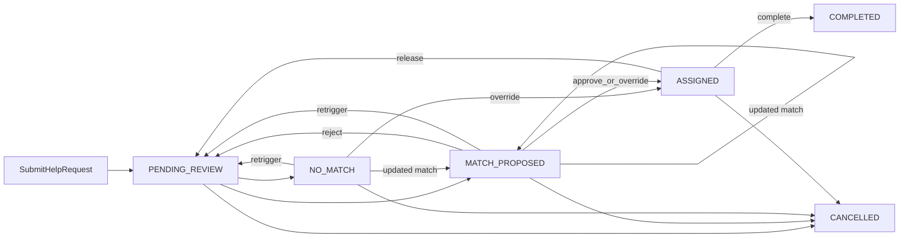

# Product & System Specification: KindBridge

Course mapping: a civic-aid request is the "open job"; proposed/assigned volunteers are the "registrants" on the dashboard (functional requirement 4.4).

> **Revision note (v1.1).** Identity is separated from roles: `users` is the person, and extensions (`volunteer_profiles`, `requester_profiles`) hang off it by `user_id`. A person can be both a requester and a volunteer. Items marked **[NEW]** or **[CHANGED]** differ from v1.0. Items marked **[DEFERRED]** are documented but not built in v1.

---

## 1. Overview and objectives

KindBridge coordinates citizen assistance requests, volunteer capacity, and AI-assisted matching. A background Deep Agent evaluates records; a human dispatcher always approves, rejects, or overrides (HITL). The agent never assigns contact details or locks a volunteer by itself.

### Locked product decisions

- Product name: **KindBridge** (not AidSync).
- Matching: **top-K = 3** proposed volunteers per request, then the dispatcher picks one.
- Volunteer consent after assignment: the volunteer may **release** (cannot perform); there is no separate pre-accept step in v1.
- **[CHANGED] Identity and roles:** one account = one person (`users` row). Roles are **derived**, not stored as a column:
  - `ADMIN` if `users.is_admin = 1`. Admin is **exclusive**: an admin account cannot submit requests and cannot volunteer.
  - `REQUESTER` for every non-admin user.
  - `VOLUNTEER` for a non-admin user with an enabled `volunteer_profiles` row.
  - A person may therefore hold `REQUESTER` and `VOLUNTEER` together.
- **[CHANGED] Enrollment is not registration.** Public registration writes only the person (`users`). From the account page, "my requests" opens `/me/requests` immediately, including the first visit, when there is no requester profile and no ticket. Adding a request is not required to open that screen. A `requester_profiles` row is still saved before a ticket is submitted. "Volunteer" opens the volunteer area immediately, even when it is empty. There is no enrollment form in front of it. That screen lists volunteering already taken on, and each taken row names the volunteering that was assigned (the profile's `experience`). On the side it lists every volunteering the person wants to do except one whose profile is assigned or completed. The side column is a display filter only: the saved volunteering is not deleted or changed. A volunteering leaves that column when the coordinator assigns that profile. It stays out after the volunteer completes the task, until a later release of that same volunteering. A release lists it again even when an earlier task on it was completed. A declined proposal does not. A proposal alone does not remove it. Cancelling an assigned request lists it again, because that profile is no longer assigned or completed. From the header, "add new volunteering" opens a blank form and inserts another `volunteer_profiles` row for that person: `primary_city` is copied from the residence city, `has_vehicle` is a checkbox used only when a request requires a vehicle, `experience` is one free-text field (domain, traits, past experience, or anything else), and `base_frequency` is how often they can help. On demand, the form asks for an optional time window. Every other frequency keeps that time window and also asks for optional weekdays. The same screen holds unavailability date ranges for the new row. Saving does not change a volunteering that was already saved. Edit on a saved row opens only its unavailability dates. The narrative, vehicle, frequency, time window, and weekdays are not on that screen. Capacity fields are not shown and stay at their defaults. Until at least one profile exists, the person is not matched. When several profiles of the same person pass the hard filter, only the one with the highest similarity is proposed. The `REQUESTER` role is still derived for every non-admin user.
- **[NEW] Self-assignment is forbidden:** a volunteer can never be proposed, approved, or overridden onto a request they created (`volunteer_profiles.user_id = help_requests.requester_id`). Enforced by one shared function (`is_self_assignment`) called from the agent filter, `ApproveAssignmentCommand`, and `OverrideAssignmentCommand`.
- Relational dialect: **Microsoft SQL Server** on Somee.com. Vector store is **ChromaDB**, not pgvector.
- Application server: **Flask**, organized as CQRS/MVC (see [architecture.md](architecture.md)).

### Primary objectives

- Track the full lifecycle of a help request.
- Semantic candidate evaluation (embeddings + RAG) plus deterministic hard constraints.
- Admin dashboard: open requests by status, candidate count per request, volunteer capacity gauges.
- Enforce inactivity, logistical capacity, schedule overlap (with a parallel-task exception), geography, unavailability periods, and mutual exemptions.

---

## 2. Authentication and identity

- **Mechanism:** JWT in HttpOnly, Secure, SameSite=Lax cookies. Access token TTL 60 minutes; no refresh tokens in v1 (the user logs in again on expiry). CSRF: double-submit cookie on mutating POST/PUT/PATCH/DELETE.
- **Password:** bcrypt (cost >= 12). Minimum 6 characters. No plaintext logs.
- **[CHANGED] RBAC:** the JWT carries `roles` as a **list** (e.g. `["REQUESTER","VOLUNTEER"]`), computed at login from `is_admin` and the volunteer profile. Every command and query checks that the list contains a role allowed for the action. Unauthorized -> 401; forbidden -> 403. If a person enables or disables the volunteer profile, the roles list refreshes on the next login (or on re-issue of the cookie after the command succeeds).
- **Bootstrap:** the first admin is created by a one-time seed (`ADMIN_BOOTSTRAP_EMAIL` in environment), not via public registration. Admin status is never granted or removed through the app.
- **Forgot-password:** out of scope for v1. Failed login lockout: 5 attempts / 15 minutes per email, tracked in the non-event-sourced `login_attempts` table.

### Personas

| Role | How obtained | Can do | Cannot do |
| :--- | :--- | :--- | :--- |
| Requester | Every public registration | Create/cancel/edit (before assignment) own requests; search/filter/detail **own** tickets; maintain own requester profile | See volunteer phone/address until `ASSIGNED`; see other requesters' tickets |
| Volunteer | Enable volunteer profile from the account page | Edit own profile; add/cancel unavailability periods; see **assigned and completed** tasks; see the requester address and phone only after completing the task; complete or release | See other volunteers; see full address before the task is `COMPLETED`; be assigned to own request |
| Admin / dispatcher | Seed only; exclusive | Dashboard, search all, read volunteer offers (assigned or not), approve/reject/override, retrigger match, reclassify concurrency, manage exemptions | Impersonate login; submit requests; volunteer |

---

## 3. Core entities (SQL Server projections)

The source of truth for domain changes is the **event store** (see [event-sourcing.md](event-sourcing.md)). Tables below are **read models** rebuilt from events, except `events` and `login_attempts`. Types are T-SQL. JSON arrays are stored as `NVARCHAR(MAX)` (`["first_aid","driving"]`).

### Entity map

```
users  (the person)
  |-- 0..N  volunteer_profiles      (each row is one volunteering the person offers)
  |-- 0..1  requester_profiles      (extension: saved defaults for a person who needs help)
  |-- 0..N  help_requests           (requester_id)
  |-- N..M  exemption_links         (volunteer user <-> requester user)

volunteer_profiles
  |-- 0..N  volunteer_unavailability
  |-- 0..N  task_assignments

help_requests
  |-- 0..N  task_assignments
  |-- 0..1  request_series          (series_id, optional)

events (event store)  |  login_attempts (lockout)
```

### 3.1 `users` [CHANGED]

| Field | Type | Constraints | Description |
| :--- | :--- | :--- | :--- |
| `id` | UNIQUEIDENTIFIER | PK | User id |
| `email` | NVARCHAR(255) | UNIQUE, NOT NULL | Login identifier (normalized lower-case) |
| `password_hash` | NVARCHAR(255) | NOT NULL | bcrypt hash; comes from the `CredentialSet` event |
| `full_name` | NVARCHAR(200) | NOT NULL | Display name |
| `phone` | NVARCHAR(400) | NOT NULL | Encrypted (app-level); ciphertext is longer than the plain number, hence 400 |
| `city` | NVARCHAR(100) | NULL | **[CHANGED]** Residence municipality. Required for a requester or volunteer. NULL for an admin |
| `home_address` | NVARCHAR(255) | NULL | **[CHANGED]** Residential street address. Plaintext. Required for a requester or volunteer. NULL for an admin |
| `is_admin` | BIT | NOT NULL, default 0 | **Replaces `role`.** Exclusive admin flag |
| `is_active` | BIT | NOT NULL, default 1 | Soft disable |
| `created_at` | DATETIME2 | NOT NULL | UTC |

There is no `role` column. See section 2 for how roles are derived.

**[CHANGED] Residence.** A requester or a volunteer has a residence `city` and `home_address` on `users`. Public registration (`RegisterUserCommand`) requires both; a blank value is rejected. An admin is neither, so the admin seed leaves both NULL and does not collect them. These fields are the person's home, not the place a help request happens. `requester_profiles.default_city` and `default_address` stay optional pre-fills for the request form and may differ. Geography matching still uses `volunteer_profiles.primary_city`. Public registration does not collect a volunteer profile. When the person enables one from the account page, the volunteer city starts as the residence city and they may change it.

### 3.2 `requester_profiles` [NEW]

Optional 1:1 extension. Holds data that repeats across a person's requests, so they do not retype it. A user without a row is still a valid requester.

| Field | Type | Constraints | Description |
| :--- | :--- | :--- | :--- |
| `id` | UNIQUEIDENTIFIER | PK | Profile id |
| `user_id` | UNIQUEIDENTIFIER | UNIQUE, FK users, NOT NULL | 1:1 with the user |
| `default_city` | NVARCHAR(100) | NULL | Pre-fills the request form |
| `default_address` | NVARCHAR(255) | NULL | Pre-fills the request form; same visibility rules as `help_requests.address` |
| `accessibility_notes` | NVARCHAR(500) | NULL | e.g. mobility limits; shown to the **assigned** volunteer only and included in the matching text |
| `emergency_contact_name` | NVARCHAR(200) | NULL | Contact for emergencies |
| `emergency_contact_phone` | NVARCHAR(400) | NULL | Encrypted (app-level) |
| `updated_at` | DATETIME2 | NOT NULL | UTC |

### 3.3 `volunteer_profiles` [CHANGED]

`experience` is the résumé embedded into ChromaDB (NFR 6), with `skills_json` appended when it is not empty. Re-embed on every successful `UpdateVolunteerProfileCommand` and on enable. The volunteering form does not collect skill categories.

| Field | Type | Constraints | Description |
| :--- | :--- | :--- | :--- |
| `id` | UNIQUEIDENTIFIER | PK | Profile id |
| `user_id` | UNIQUEIDENTIFIER | FK users, NOT NULL, indexed | The person. One person may have many rows |
| `is_enabled` | BIT | NOT NULL, default 1 | **[NEW]** Volunteer role switch. Disabling keeps all data |
| `primary_city` | NVARCHAR(100) | Indexed, NOT NULL | Home municipality. Copied from `users.city` when add-volunteering omits it. The form does not ask again |
| `has_vehicle` | BIT | NOT NULL, default 0 | Transport available. A checkbox on add-volunteering. The agent uses it only when the request has `requires_vehicle = 1`. It is not asked on each task |
| `skills_json` | NVARCHAR(MAX) | NOT NULL | JSON string array. May be `[]`. The volunteering form does not edit this list |
| `experience` | NVARCHAR(MAX) | NOT NULL | One free-text field: domain, traits, past experience, or anything else the volunteer writes | 
| `base_frequency` | NVARCHAR(30) | NOT NULL | `WEEKLY`, `BIWEEKLY`, `MONTHLY`, `ON_DEMAND` (one-off / as needed). **Soft** score bonus, never a hard filter |
| `preferred_time_from` | TIME | NULL | Optional start of the time window. Collected for every `base_frequency`. Not a hard filter |
| `preferred_time_to` | TIME | NULL | Optional end of that window. Both ends are stored, or neither. Not a hard filter |
| `preferred_weekdays_json` | NVARCHAR(100) | NULL | Optional weekdays (`SUN` through `SAT`) when `base_frequency` is not `ON_DEMAND`. NULL means no preference. Not a hard filter |
| `availability_status` | NVARCHAR(30) | NOT NULL, default `AVAILABLE` | Stored values: `AVAILABLE`, `INACTIVE`. See availability rules |
| `max_active_tasks` | INT | NOT NULL, default 1 | **[CHANGED]** Cap for `EXCLUSIVE` tasks |
| `max_parallel_tasks` | INT | NOT NULL, default 2 | **[NEW]** Cap for `PARALLEL_OK` tasks. 0 = "I do not want parallel tasks" |
| `current_active_tasks` | INT | NOT NULL, default 0 | **Projection**: `ASSIGNED` `EXCLUSIVE` tasks. Never written by a query |
| `current_parallel_tasks` | INT | NOT NULL, default 0 | **[NEW]** Projection: `ASSIGNED` `PARALLEL_OK` tasks |

`unavailable_until` from v1.0 is **removed**; unavailability periods now live in `volunteer_unavailability` (3.4).

**Availability rules**

- `INACTIVE`: set by the volunteer toggle only in v1 (automatic 90-day inactivity is deferred). The agent skips `INACTIVE`.
- `TEMPORARILY_UNAVAILABLE` is a **derived display value**: it applies when an active `volunteer_unavailability` period covers today. No scheduler; eligibility is evaluated lazily at match time.
- `BUSY` is a derived display value: `current_active_tasks >= max_active_tasks`.
- The agent skips a volunteer if `has_vehicle = 0` and the request has `requires_vehicle = 1`.
- A volunteer with `is_enabled = 0` is never matched, and their existing tasks follow the rules in section 4.3.

### 3.4 `volunteer_unavailability` [NEW]

Date ranges when a volunteer cannot help. A volunteer may have many.

| Field | Type | Constraints | Description |
| :--- | :--- | :--- | :--- |
| `id` | UNIQUEIDENTIFIER | PK | Period id |
| `volunteer_id` | UNIQUEIDENTIFIER | FK volunteer_profiles, NOT NULL | Volunteer |
| `from_date` | DATE | NOT NULL | Start (inclusive) |
| `until_date` | DATE | NOT NULL, `>= from_date` | End (inclusive) |
| `reason` | NVARCHAR(200) | NULL | Internal note, never shown to requesters |
| `is_cancelled` | BIT | NOT NULL, default 0 | Soft cancel |
| `created_at` | DATETIME2 | NOT NULL | UTC |

A volunteer is excluded when the request's `preferred_date` falls inside a non-cancelled period. If the request has no `preferred_date`, today's date is used. Adding a period that covers the date of an `ASSIGNED` task is rejected with 409 until the task is released.

### 3.5 `help_requests` [CHANGED]

| Field | Type | Constraints | Description |
| :--- | :--- | :--- | :--- |
| `id` | UNIQUEIDENTIFIER | PK | Ticket id |
| `requester_id` | UNIQUEIDENTIFIER | FK users, NOT NULL | Owner. Can be a person who is also a volunteer |
| `series_id` | UNIQUEIDENTIFIER | FK request_series, NULL | **[NEW] [DEFERRED]** NULL = one-off request |
| `city` | NVARCHAR(100) | Indexed, NOT NULL | Municipality |
| `address` | NVARCHAR(255) | NOT NULL | Street address; hidden from a volunteer until that volunteer completes the task |
| `category` | NVARCHAR(50) | NOT NULL | Aid domain (enum in app; list defined in architecture.md) |
| `resource_type` | NVARCHAR(30) | NOT NULL | **[CHANGED]** Not chosen on the form. `UNKNOWN` at submit, then `PHYSICAL_PRESENCE`, `EQUIPMENT_LOAN`, or `FLEXIBLE_REMOTE` after classification. See delivery below |
| `description` | NVARCHAR(MAX) | NOT NULL | Narrative of need. The form asks for as much detail as possible, because this text is what matching embeds |
| `urgency` | NVARCHAR(20) | NOT NULL | `LOW`, `NORMAL`, `HIGH`, `EMERGENCY` |
| `frequency` | NVARCHAR(30) | NOT NULL | **[CHANGED]** `ON_DEMAND`, `WEEKLY`, `BIWEEKLY`, `MONTHLY`. How often this help is needed. Same values as a volunteer's `base_frequency`. Soft score only. It does not create a `request_series` |
| `preferred_date` | DATE | NULL | Target date |
| `preferred_time_from` | TIME | NULL | Window start |
| `preferred_time_to` | TIME | NULL | Window end |
| `preferred_weekdays_json` | NVARCHAR(100) | NULL | Optional preferred weekdays, a JSON array of `SUN`, `MON`, `TUE`, `WED`, `THU`, `FRI`, `SAT`. NULL means no preference. Shown next to the time window only when frequency is not `ON_DEMAND`. Not a hard filter |
| `estimated_duration_min` | INT | NULL | **[CHANGED]** Not collected. New tickets store null. A stored value on an older row still extends a start time that has no end |
| `required_skills_json` | NVARCHAR(MAX) | NOT NULL | **[CHANGED]** The form does not collect skills. New tickets store `[]`. An empty list does not separate candidates |
| `requires_vehicle` | BIT | NOT NULL, default 0 | True only if transport is required. The requester still checks this on the form. Independent of `resource_type` |
| `concurrency_type` | NVARCHAR(20) | NOT NULL, default `UNKNOWN` | **[NEW]** `EXCLUSIVE`, `PARALLEL_OK`, `UNKNOWN`. See 4.4 |
| `status` | NVARCHAR(30) | Indexed, NOT NULL | See request state machine |
| `match_attempt` | INT | NOT NULL, default 0 | Incremented each ProposeMatch; used for idempotency |
| `created_at` | DATETIME2 | NOT NULL | UTC |

`requires_vehicle` is the vehicle flag. The create form collects category, urgency, description, frequency, that checkbox, an optional time window, optional preferred weekdays (one or more), city, and address. On demand shows the time window and hides weekdays. Every other frequency keeps that time window and also shows the weekdays. The form does not collect a preferred date, skills, a duration, or how the help is delivered. Preferred weekdays are not stored for `ON_DEMAND`.

**Delivery.** `resource_type` is how the work is delivered (on-site vs remote vs equipment). Do not duplicate `EQUIPMENT_VEHICLE`. The requester does not choose it. At the start of `ProposeMatch`, when the value is `UNKNOWN`, classify it before the geography check and before concurrency. Phrases in the description win, in this order: equipment language (`השאלה`, `ציוד`, equipment, lending) → `EQUIPMENT_LOAN`; remote language (remote, phone, zoom, `מרחוק`) → `FLEXIBLE_REMOTE`; on-site language (`להגיע`, `בבית`, in person, at home) → `PHYSICAL_PRESENCE`. Otherwise `tutoring` and `translation` lean `FLEXIBLE_REMOTE`, and every other category leans `PHYSICAL_PRESENCE`. The reason is stored on `ResourceTypeClassified`, not in a column. `UNKNOWN` is treated as on-site if a filter runs before that classification. Concurrency is then classified from the resulting resource type (4.4).

### 3.6 `request_series` [NEW] [DEFERRED]

Reserved for recurring requests. In v1 no UI or command creates a series and `help_requests.series_id` stays NULL. Each occurrence of a future series is an ordinary `help_requests` row with its own lifecycle, so the state machine does not change.

| Field | Type | Constraints | Description |
| :--- | :--- | :--- | :--- |
| `id` | UNIQUEIDENTIFIER | PK | Series id |
| `requester_id` | UNIQUEIDENTIFIER | FK users, NOT NULL | Requester |
| `recurrence` | NVARCHAR(20) | NOT NULL | `WEEKLY`, `BIWEEKLY`, `MONTHLY` |
| `start_date` | DATE | NOT NULL | First occurrence |
| `end_date` | DATE | NULL | NULL = open-ended |
| `preferred_volunteer_id` | UNIQUEIDENTIFIER | FK volunteer_profiles, NULL | Soft score bonus for continuity, never a lock |
| `is_active` | BIT | NOT NULL, default 1 | Stop the series |

### 3.7 `task_assignments`

Multiple rows per request (up to K proposals). At most **one** row in `ASSIGNED` or `COMPLETED` per request (filtered unique index).

| Field | Type | Constraints | Description |
| :--- | :--- | :--- | :--- |
| `id` | UNIQUEIDENTIFIER | PK | Assignment id |
| `request_id` | UNIQUEIDENTIFIER | FK help_requests, NOT NULL | Parent ticket |
| `volunteer_id` | UNIQUEIDENTIFIER | FK volunteer_profiles, NOT NULL | Candidate |
| `ai_score` | DECIMAL(5,2) | NULL, 0.00-100.00 | KindBridge score; NULL for a manual override |
| `ai_rationale` | NVARCHAR(500) | NULL | Short justification; NULL for a manual override |
| `rank_in_batch` | INT | NULL | 1..K in this match_attempt; NULL for a manual override |
| `match_attempt` | INT | NOT NULL | Ties to request.match_attempt |
| `approved_by` | UNIQUEIDENTIFIER | NULL, FK users | Dispatcher |
| `status` | NVARCHAR(30) | NOT NULL | `PROPOSED`, `ASSIGNED`, `DECLINED`, `COMPLETED`, `SUPERSEDED` |
| `decline_reason` | NVARCHAR(500) | NULL | Reject, release, or override leftover |
| `override_reason` | NVARCHAR(500) | NULL | Required on override |
| `updated_at` | DATETIME2 | NOT NULL | UTC |

`current_active_tasks` and `current_parallel_tasks` count only `ASSIGNED` rows (never `COMPLETED`), split by the request's `concurrency_type`.

### 3.8 `exemption_links` [CHANGED]

| Field | Type | Constraints | Description |
| :--- | :--- | :--- | :--- |
| `volunteer_id` | UNIQUEIDENTIFIER | Composite PK, FK **users** | Excluded volunteer (user id, consistent with `requester_id`) |
| `requester_id` | UNIQUEIDENTIFIER | Composite PK, FK users | Requester |
| `created_by` | UNIQUEIDENTIFIER | FK users, NOT NULL | Admin or volunteer |
| `reason` | NVARCHAR(300) | NOT NULL | Why |
| `created_at` | DATETIME2 | NOT NULL | UTC |

Permanent for v1 (no undelete UI). Creating a link while an assignment is `ASSIGNED` is rejected; cancel or release first.

### 3.9 `events` (event store) [NEW definition]

The source of truth. All tables above except `login_attempts` are rebuilt from it.

| Field | Type | Constraints | Description |
| :--- | :--- | :--- | :--- |
| `event_id` | UNIQUEIDENTIFIER | PK | Event id |
| `stream_id` | UNIQUEIDENTIFIER | NOT NULL | Aggregate id (user or help request) |
| `stream_type` | NVARCHAR(50) | NOT NULL | `User`, `HelpRequest` |
| `version` | INT | NOT NULL | Sequence within the stream |
| `event_type` | NVARCHAR(100) | NOT NULL | e.g. `HelpRequestCreated` |
| `payload` | NVARCHAR(MAX) | NOT NULL | JSON |
| `occurred_at` | DATETIME2 | NOT NULL | UTC |

Constraint: `UNIQUE (stream_id, version)` gives optimistic concurrency; a concurrent writer gets 409. Volunteer profile, requester profile, and unavailability events live in the **User** stream (same person).

### 3.10 `login_attempts` (not event-sourced) [NEW definition]

| Field | Type | Constraints | Description |
| :--- | :--- | :--- | :--- |
| `id` | BIGINT | PK, IDENTITY | Row id |
| `email` | NVARCHAR(255) | Indexed, NOT NULL | Email attempted |
| `attempted_at` | DATETIME2 | NOT NULL | UTC |
| `succeeded` | BIT | NOT NULL | Result |

Lockout: 5 failures within 15 minutes for the same email.

---

## 4. Matching rules and state machines

### 4.1 Help request status

`PENDING_REVIEW` -> `MATCH_PROPOSED` | `NO_MATCH`. A later check of `MATCH_PROPOSED` or `NO_MATCH` stays put when the ordered volunteers do not change, and becomes `MATCH_PROPOSED` when they do, then -> `ASSIGNED` -> `COMPLETED`. `NO_MATCH` -> `PENDING_REVIEW` (retrigger) or `ASSIGNED` (override).
`ASSIGNED` -> `PENDING_REVIEW` when the volunteer releases.
Any of `PENDING_REVIEW`, `MATCH_PROPOSED`, `NO_MATCH`, `ASSIGNED` -> `CANCELLED`.



| Current | Command | Event | Next | Invariants |
| :--- | :--- | :--- | :--- | :--- |
| - | `RegisterUserCommand` | `UserRegistered` (+ `VolunteerProfileEnabled` if the form includes a volunteer profile) | (user exists) | No role in payload. `is_admin` is never set here. `city` and `home_address` are required. The admin seed does not set them |
| - | `LoginCommand` | `UserLoggedIn` | - | Audit only; no domain status |
| - | `SubmitHelpRequestCommand` | `HelpRequestCreated` | `PENDING_REVIEW` | Non-admin with a requester profile; enqueue agent. `resource_type` is `UNKNOWN`, `required_skills` is `[]`, `estimated_duration_min` is null, and `frequency` is one of the four cadence values |
| `PENDING_REVIEW` | `ClassifyConcurrencyCommand` | `ConcurrencyClassified` | (unchanged) | **[NEW]** Agent or admin. See 4.4 |
| `PENDING_REVIEW` | `ProposeMatchCommand` | `MatchesProposed` | `MATCH_PROPOSED` | Agent only; writes 1..K `PROPOSED` rows; increments `match_attempt`; applies the hard filter in 4.2 |
| `MATCH_PROPOSED` or `NO_MATCH` | `ProposeMatchCommand` | `MatchesProposed` (`updated: true`; `found: true` only after `NO_MATCH`) | `MATCH_PROPOSED` | Agent re-checks both until the request is assigned, using the same rules. Writes a new batch only when the ordered volunteer ids differ; previous `PROPOSED` -> `SUPERSEDED`; admins get one mail. After `NO_MATCH` that mail says a match has now been found; otherwise it says the proposal was updated. The same ids, or an empty new pool, append nothing and send no mail. An empty re-check of `NO_MATCH` stays `NO_MATCH` |
| `PENDING_REVIEW` | `ProposeMatchCommand` (empty pool) | `NoMatchFound` | `NO_MATCH` | Admin notified; no assignment rows; payload carries the **rejection summary** (counts per filter reason). A refresh of `MATCH_PROPOSED` or `NO_MATCH` does not take this path |
| `NO_MATCH` or `MATCH_PROPOSED` | `RetriggerMatchCommand` | `MatchRetriggered` | `PENDING_REVIEW` | Admin; previous `PROPOSED` -> `SUPERSEDED` |
| `MATCH_PROPOSED` | `ApproveAssignmentCommand` | `AssignmentApproved` | `ASSIGNED` | Admin; fails if `is_self_assignment` or the volunteer no longer passes the capacity/overlap checks; chosen assignment -> `ASSIGNED`; siblings -> `SUPERSEDED`; increment the matching volunteer counter; Gmail notify volunteer (and requester); do not expose address or phone yet; the volunteer sees them only after `COMPLETED` |
| `MATCH_PROPOSED` | `RejectAssignmentCommand` | `AssignmentsRejected` | `PENDING_REVIEW` | Admin; **all** current `PROPOSED` -> `DECLINED` with reason; those volunteers blacklisted for **this request only**; re-queue agent |
| `NO_MATCH` or `MATCH_PROPOSED` | `OverrideAssignmentCommand` | `AssignmentOverridden` | `ASSIGNED` | Admin picks any volunteer who passes the hard filter (including `is_self_assignment`); `override_reason` required; creates an `ASSIGNED` row with NULL score, rationale, rank; current `PROPOSED` -> `SUPERSEDED`; counter + notify |
| `ASSIGNED` | `CompleteTaskCommand` | `TaskCompleted` | `COMPLETED` | Assigned volunteer only; decrement counter; request terminal; that volunteer then sees the requester address and phone |
| `ASSIGNED` | `ReleaseTaskCommand` | `TaskReleased` | `PENDING_REVIEW` | Assigned volunteer; assignment -> `DECLINED`; volunteer blacklisted on this request; decrement counter; re-queue; notify requester |
| Open states | `CancelRequestCommand` | `HelpRequestCancelled` | `CANCELLED` | Owner (or admin); if `ASSIGNED`, notify volunteer via Gmail and free capacity; open proposals -> `SUPERSEDED` |

**No edit in v1.** The owner does not change a request in place. To replace one, they cancel it and submit a new ticket. There is no `UpdateHelpRequestCommand` and no `HelpRequestUpdated` event.

**Concurrency control:** optimistic version on the request aggregate (`match_attempt` + event stream version). A second approve/override fails with 409.

**Past `preferred_date`:** still matchable; the agent adds a score penalty; the dashboard shows an `OVERDUE` badge. `EMERGENCY` uses a higher urgency weight (see [agent-and-mcp.md](agent-and-mcp.md)), not a separate queue. For a real medical emergency the UI shows a notice to call the national emergency number; KindBridge is not an emergency service.

### 4.2 Hard filter (deterministic, not LLM)

Stage 1 of `ProposeMatchCommand`. It runs as plain code (a SQL query / MCP tool), so results are reproducible and testable. A volunteer failing **any** check is excluded.

| # | Check | Excluded when |
| :--- | :--- | :--- |
| 1 | Role active | `volunteer_profiles.is_enabled = 0`, `users.is_active = 0`, or `availability_status = INACTIVE` |
| 2 | Not the same person | `volunteer_profiles.user_id = help_requests.requester_id` |
| 3 | Exemption | An `exemption_links` row exists for the volunteer user and the requester |
| 4 | Declined before | The volunteer has a `DECLINED` assignment on this request (reject or release) |
| 5 | Unavailability | `preferred_date` (or today) falls inside a non-cancelled `volunteer_unavailability` period |
| 6 | Geography | `resource_type` is `PHYSICAL_PRESENCE`, `EQUIPMENT_LOAN`, or still `UNKNOWN`, and the volunteer city is not the same municipality as the request city. Hebrew and English names of a known municipality match (`חיפה` and `Haifa`); hyphens and extra spaces are ignored. An unknown place matches only the same folded text. `FLEXIBLE_REMOTE` ignores city. A radius is deferred |
| 7 | Vehicle | `requires_vehicle = 1` and `has_vehicle = 0` |
| 8 | Capacity | Per the concurrency rules in 4.4 |
| 9 | Schedule overlap | Per the concurrency rules in 4.4 |

`SUPERSEDED` rows are leftover proposals, not a blacklist. The filter also records **why** each volunteer was excluded (counts per check) in the `NoMatchFound` payload so the dispatcher sees what is missing before deciding on an override. A person with several profiles is one volunteer: after the checks, only their highest-similarity profile stays in the candidate list. A `DECLINED` assignment on any of their profiles keeps every profile of that person off this request.

### 4.3 Changes after assignment

- **Volunteer adds an unavailability period over an `ASSIGNED` task, or sets `INACTIVE`, or disables the profile:** rejected with 409 while they hold an `ASSIGNED` task; they must release first.
- **Requester edits an `ASSIGNED` request:** not allowed; cancel and resubmit.
- **User is deactivated (`is_active = 0`):** open requests they own are cancelled; tasks they hold are released.

### 4.4 Concurrency (parallel tasks)

Some tasks can run alongside others (a short phone check-in) and some cannot (accompanying someone to a doctor). The **agent classifies**; the result is **stored** so the hard filter stays deterministic.

| `concurrency_type` | Meaning | Typical |
| :--- | :--- | :--- |
| `EXCLUSIVE` | Needs full presence/attention | Escort, shopping, physical help at home |
| `PARALLEL_OK` | Can run beside other tasks | Remote call, short equipment drop-off |
| `UNKNOWN` | Not yet classified | Treated as `EXCLUSIVE` by the filter |

**Classification.** `ClassifyConcurrencyCommand` is called by the agent at the start of `ProposeMatch` when the value is `UNKNOWN`, and may be called by an admin to override. Defaults: `FLEXIBLE_REMOTE` leans `PARALLEL_OK`, `PHYSICAL_PRESENCE` leans `EXCLUSIVE`; the agent deviates only with a reason from the description. The reasoning is stored in the `ConcurrencyClassified` event payload, not in a table column.

**Capacity (check 8).**
- `EXCLUSIVE` request: `current_active_tasks < max_active_tasks`.
- `PARALLEL_OK` request: `current_parallel_tasks < max_parallel_tasks`.

**Overlap (check 9).** Two tasks of the same volunteer may overlap in time only if **both** are `PARALLEL_OK`.
- With a time window (`preferred_time_from` and `preferred_time_to`): compare the intervals on the same date. The form does not collect a duration. A stored `estimated_duration_min` on an older row still extends a start time that has no end.
- Without a window: two `EXCLUSIVE` tasks on the same date are treated as overlapping; a `PARALLEL_OK` task is not blocked by date alone.

### 4.5 Assignment status

`PROPOSED` -> `ASSIGNED` | `DECLINED` | `SUPERSEDED`
`ASSIGNED` -> `COMPLETED` | `DECLINED` (on release/cancel)

### 4.6 Scoring (stage 2, soft)

Only volunteers who passed 4.2 are ranked. Inputs: semantic similarity between the request text (description, category, frequency, and requester accessibility notes) and the volunteer resume (ChromaDB, weight 0.55); travel feasibility (weight 0.20); urgency (weight 0.15); vehicle fit (weight 0.05); frequency fit between the request `frequency` and the volunteer's `base_frequency` (weight 0.05, never a hard filter); continuity bonus (series, deferred); overdue penalty. A one-off request (`ON_DEMAND`) keeps the volunteer bonus (`ON_DEMAND` 1.0, `WEEKLY` 0.9, `BIWEEKLY` 0.8, `MONTHLY` 0.7). The same cadence is 1.0. A volunteer who can help at least that often is 0.9. An on-demand volunteer for a repeating cadence is 0.75. A less frequent volunteer is 0.5. Top **3** become `PROPOSED` with `ai_score` and `ai_rationale`. Details in [agent-and-mcp.md](agent-and-mcp.md).

---

## 5. Commands and queries (complete list)

**Commands:**
`RegisterUserCommand`, `LoginCommand`, `UpdateAccountDetailsCommand`,
`EnableVolunteerProfileCommand` [NEW], `UpdateVolunteerProfileCommand`, `DisableVolunteerProfileCommand` [NEW],
`AddVolunteerUnavailabilityCommand` [NEW], `CancelVolunteerUnavailabilityCommand` [NEW],
`UpdateRequesterProfileCommand` [NEW],
`SubmitHelpRequestCommand`, `CancelRequestCommand`,
`ClassifyConcurrencyCommand` [NEW] (agent/admin),
`ProposeMatchCommand` (agent), `RetriggerMatchCommand`, `ApproveAssignmentCommand`, `RejectAssignmentCommand`, `OverrideAssignmentCommand`,
`CompleteTaskCommand`, `ReleaseTaskCommand`,
`CreateExemptionLinkCommand`.

`SetVolunteerAvailabilityCommand` from v1.0 is replaced by the INACTIVE toggle inside `UpdateVolunteerProfileCommand` plus the two unavailability commands.

**Queries:**
`GetAdminDashboardQuery`, `SearchHelpRequestsQuery` (role-scoped filters: category, city, urgency, status), `GetHelpRequestDetailsQuery`, `GetVolunteerTasksQuery`, `GetMyRequestsQuery` (owner's tickets; same filters, default status group is the open statuses), `GetMyProfilesQuery` [NEW] (the caller's volunteer profile and open unavailability periods), `GetVolunteerDirectoryQuery` (admin), `GetAssignmentCandidatesQuery`.

`GetVolunteerOffersQuery` (admin) reads enabled volunteer profiles of active users on `GET /admin/volunteers`. A profile is assigned when it has a `task_assignments` row in `ASSIGNED` (the screen links that request and shows its category and city) and unassigned otherwise; `page` and `assignment` (`all`, `assigned`, `unassigned`) only filter the read. Phone and address are not shown.

**Events (new or changed in v1.1):** `UserRegistered` (no role), `UserDetailsUpdated`, `VolunteerProfileEnabled`, `VolunteerProfileUpdated`, `VolunteerProfileDisabled`, `VolunteerUnavailabilityAdded`, `VolunteerUnavailabilityCancelled`, `RequesterProfileUpdated`, `ConcurrencyClassified`, `ResourceTypeClassified`. Payload definitions go in [event-sourcing.md](event-sourcing.md). `HelpRequestUpdated` is not emitted.

---

## 6. User workflows (course 4.1-4.5)

1. **Data entry:** register with name, email, phone, password, residence city, and home address only. From the account page, "my requests" opens the help-request area without a requester profile and without a ticket. A requester profile is still saved before a ticket is submitted. The volunteer area opens without a profile, with an empty taken-on list and an empty want-to-do column. "Add new volunteering" on that area saves the vehicle checkbox, one free-text narrative, frequency, an optional time window for every frequency, optional weekdays when frequency is not on demand, and optional unavailability dates; the city is the residence city. Opening that form again adds another volunteering and leaves the saved ones unchanged. Edit on a saved volunteering opens only its unavailability dates. That volunteering is omitted from the want-to-do column while its profile is assigned or completed. The omission is display only. It returns after a release, including a release that follows an earlier completion of that same volunteering, and after an assigned request is cancelled. Completing the task keeps it omitted until such a release. A declined proposal does not return it. A proposal does not omit it. A requester then creates a ticket with category, urgency, a detailed description, frequency, whether a vehicle is required, an optional time window, optional preferred weekdays, city, and address. On demand, that form shows the time window and no weekdays. Every other frequency shows the time window and the weekdays. The form does not ask for a preferred date. Skills, duration, and delivery mode are not on that form. A ticket is not edited; the owner cancels it and submits a new one. Names, cities, addresses, and the narrative may be entered in Hebrew or English and are stored as written. On SQL Server those columns are bound as NVARCHAR so Hebrew is kept.
2. **Search:** filters on category, city, urgency, status (requester: own rows; admin: all; volunteer: assigned tasks).
3. **Table:** queues, candidates per ticket, history.
4. **Detail:** narrative, scoped location, AI score breakdown for each of the K candidates, concurrency type, exclusion summary when `NO_MATCH`.
5. **Dashboard (4.4):** open requests by status; **count of proposed + assigned candidates per request**; volunteer gauges Available / Busy / Inactive.

A person with both roles sees a role switcher ("I need help" / "I volunteer") in the UI. Screen-level UI is in [ui-ux.md](ui-ux.md). Tests for edges are in [test-plan.md](test-plan.md).

---

## 7. Out of scope for v1 (documented, not built)

| Item | Note |
| :--- | :--- |
| Recurring requests (`request_series`) | Table reserved; `series_id` stays NULL |
| Weekly availability slots (e.g. "Tuesday afternoons only") | Possible `volunteer_availability_slots` in v2 |
| Capacity checked per date | v1 uses current counters; revisit with recurring requests |
| Geographic radius | v1 matches the same municipality, including Hebrew and English names; a radius is deferred |
| Stuck proposals / tasks (timeouts, reminders, task-level `OVERDUE`) | v2 |
| No-show handling, reopening a `COMPLETED` request | v2 |
| Feedback / rating of volunteers | v2 |
| Requester notifications beyond the events listed in 4.1 | v2 |
| Account deletion and privacy (crypto-shredding of personal data in events) | Needs a design decision before production |
| Hebrew embedding quality | Choose and test a multilingual embedding model before relying on semantic scores |
| Forgot-password, refresh tokens, 90-day auto-inactivity | v2 |

---

## 8. Files to update for consistency

When this version is adopted, search every document and rule for the old assumption (`role` as a column, "role immutable", "one role per account") and update:

| File | Change |
| :--- | :--- |
| `event-sourcing.md` | New and changed events (section 5); profile and unavailability events in the User stream |
| `architecture.md` | Flask + CQRS/MVC layout; `roles` list in JWT; shared `is_self_assignment`; category enum; MCP tools (see below) |
| `agent-and-mcp.md` | Two-stage matching (4.2 deterministic filter as an MCP tool, 4.6 scoring), concurrency classification, Tavily web search, Gmail MCP |
| `rules-and-skills.md`, `.cursor/rules/kindbridge-cqrs.mdc` | Role checks use the roles list; no writes from queries; filter code stays deterministic |
| `test-plan.md` | Volunteer submits own request; self-assignment blocked in propose/approve/override; admin cannot submit; unavailability covering the request date; city mismatch; parallel vs exclusive overlap; edit-after-proposal supersedes; 409 on adding unavailability over an assigned task |
| `ui-ux.md` | Role switcher; requester profile screen; unavailability management; exclusion summary on `NO_MATCH` |